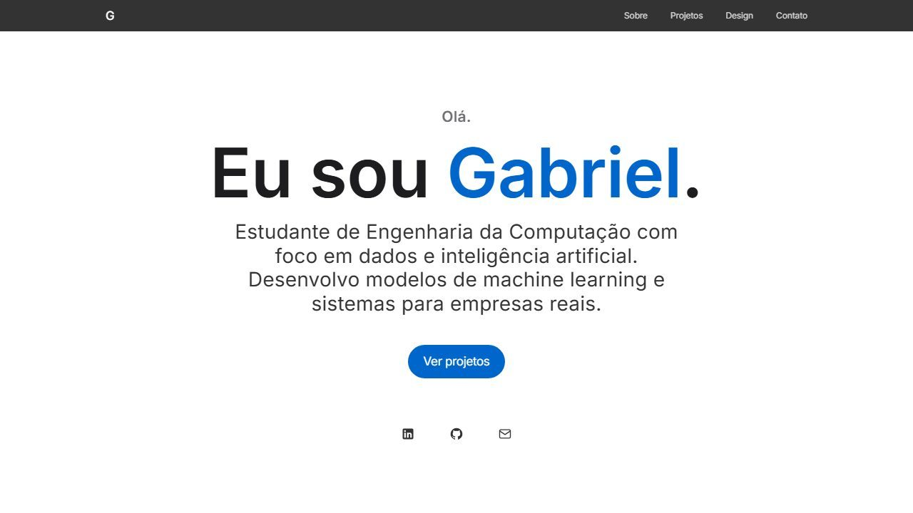

# Portfólio de Gabriel Gomes Pimentel

Site pessoal com meus projetos em dados, machine learning e desenvolvimento de sistemas, feito em HTML, CSS e JavaScript puros.

**Site no ar:** https://gabriel-gomes-pimentel.github.io/portifolio-desenvolvedor/



## Sobre

Sou estudante de Engenharia da Computação no Inteli e curso Análise e Desenvolvimento de Sistemas na FGV, em São Paulo. O site reúne os projetos que entreguei a empresas parceiras no Inteli e na Inteli Júnior, minha stack e minha trajetória.

## Projetos em destaque

- **Safira** (Azul Linhas Aéreas): modelo de machine learning que prevê detratores de NPS antes da resposta à pesquisa.
- **Safra Control** (ATVOS): CRM web de parceiros agrícolas, aprovado e em produção.
- **As Aventuras de Marcielo** (Cielo): serious game web aprovado para os treinamentos da empresa.
- **Refúgios climáticos** (SEMASA Santo André): dispositivo IoT que mede temperatura e umidade em pontos de sombra. Em andamento.
- **TROP Cargo** (Inteli Júnior): plataforma de CRM e cotações para uma empresa de logística. Em andamento.
- **JusAjuda**: integração ao banco de dados, publicação em domínio próprio e otimização de uma plataforma de acesso à justiça.

## Tecnologias

- HTML, CSS e JavaScript puros, sem frameworks nem bibliotecas
- Figma, para o design system e o protótipo
- GitHub Pages, para a publicação

## Estrutura de pastas

```
portifolio-desenvolvedor/
├── index.html          página principal
├── css/style.css       design system (variáveis) e estilos
├── js/main.js          animações, menu e formulário de contato
├── projetos/           páginas de detalhe de cada projeto
└── assets/             imagens, favicon e currículo em PDF
```

## Como rodar localmente

O site é estático. Basta clonar o repositório e abrir o `index.html` no navegador:

```bash
git clone https://github.com/Gabriel-Gomes-Pimentel/portifolio-desenvolvedor.git
cd portifolio-desenvolvedor
```

Para servir com um servidor local, rode `python -m http.server 8000` na pasta e acesse http://localhost:8000.

## Design

O design system e o protótipo foram feitos no Figma antes do código: [abrir no Figma](https://www.figma.com/design/Wm77g3Bp40BQ5uYXYfrb5N/Portf%C3%B3lio-Gabriel-Gomes-Pimentel-%E2%80%94-Design-System---Prot%C3%B3tipo?node-id=64-53).

O portfólio foi desenvolvido com auxílio da inteligência artificial Claude (Anthropic). As decisões estruturais, de conteúdo e de design foram tomadas por mim. A IA atuou como ferramenta de implementação técnica.
